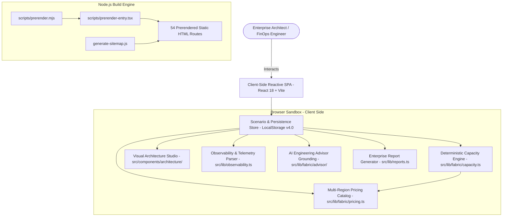
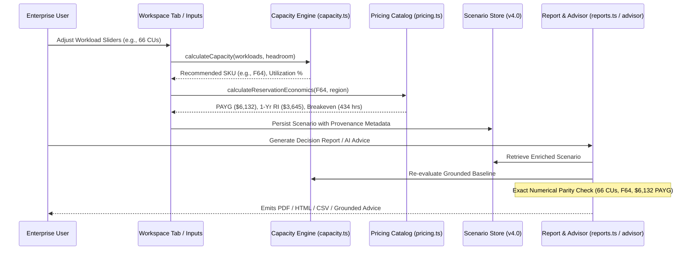

# Fabric Master v4.0 — Target Architecture Specification

**Status:** Implementation Complete & Production Ready  
**Version:** 4.0.0  
**Last Updated:** October 2026  
**Document Classification:** Architecture Specification  

---

## 1. Executive Architecture Overview

Fabric Master v4.0 is engineered as a zero-dependency, local-first enterprise engineering and FinOps workbench for Microsoft Fabric. The architecture balances high-fidelity client-side interactive modeling (reactive state, sub-millisecond calculation recalculations, visual diagramming) with static prerendering for search engine indexability and privacy-conscious zero-telemetry exfiltration.

---

## 2. Layered Architecture Breakdown

### 2.1 Presentation Layer (`src/pages/`, `src/components/`)
- **Homepage (`src/pages/Home.tsx`):** Enterprise landing page with interactive SKU hierarchy navigator, value pillars, and deep-link routing.
- **Unified Workspace (`src/pages/Workspace.tsx`):** Central engineering hub with 7 unified tabs:
  1. Overview & Health
  2. Capacity Sizing Wizard
  3. FinOps & Pricing Studio
  4. Architecture Studio
  5. Scenario Comparison (Side-by-side delta)
  6. Migration Evaluator (Synapse/ADLS/Power BI)
  7. Observability & Telemetry Diagnostics
- **Observability Studio (`src/pages/Observability.tsx`):** Standalone telemetry diagnostic workbench supporting Microsoft Fabric Capacity Metrics CSV/JSON ingestion, smoothing amortization charts, borrow pool saturation, and engine consumption breakdown.
- **AI Advisor v2 (`src/pages/AIAdvisor.tsx`):** Grounded engineering advisor with deterministic mathematical transparency, 5 specialized reasoning tasks, prompt injection defense, and raw audit exports.
- **Report Viewer (`src/pages/Report.tsx`):** Five-page C-suite decision report renderer with live print-to-PDF, standalone HTML download, and CSV export.
- **Design System (`src/index.css`, `src/components/Layout.tsx`):** Slate dark-mode design system with Tailwind-free vanilla CSS tokens, WCAG 2.2 AA contrast, accessible focus rings, and responsive navigation drawer.

### 2.2 Computation & Business Logic Layer (`src/lib/`)
- **Capacity Engine (`src/lib/fabric/capacity.ts`):** Deterministic CU evaluation, concurrent daytime burst modeling, 50% / 15% headroom evaluation, SKU tier snapping (F2 to F2048), and edge-case safety.
- **Pricing Catalog (`src/lib/fabric/pricing.ts`):** 11 global Azure regions, PAYG vs 1-Year Reserved Instance formulas, 434-hour break-even calculations, currency formatting, and sovereign cloud guidance.
- **Observability & Smoothing (`src/lib/observability.ts`):** 24-hour background sliding window smoothing, 5-minute interactive smoothing, throttling warning detectors, and scenario reality-check comparator.
- **AI Advisor Engine (`src/lib/fabric/advisor/`):** Mathematical scenario grounding, input sanitization (`sanitizeAdvisorInput`), and structured explainability reports across 5 task types.
- **Report Generator (`src/lib/reports.ts`):** Self-contained, zero-external-dependency HTML/CSV generator guaranteeing exact numerical parity with workspace calculations.

### 2.3 Persistence & Storage Layer (`src/lib/workspace/scenarioStorage.ts`)
- **Local-First Storage:** LocalStorage key `fabric_workspace_scenarios_v4`.
- **Schema Validation & Migration:** Strict v4.0 schema enforcement with sanitization of untrusted script tags, backward-compatible migration from legacy schemas, and safe fallback handling.
- **Data Sovereignty:** Client workload metrics and imported telemetry are processed purely in-memory within the user's browser sandbox; zero bytes are transmitted to external servers.

### 2.4 Build, Prerender & SEO Layer
- **Static Site Generation (`scripts/prerender.mjs`, `scripts/prerender-entry.tsx`):** 54 static routes prerendered into `dist/*.html` at build time, ensuring fast Time-to-First-Byte (TTFB) and search engine indexing.
- **Sitemap Generator (`generate-sitemap.js`):** Emits compliant `public/sitemap.xml` filtering out experimental/noindex routes.
- **Security Headers (`vercel.json`):** Strict CSP, HSTS, `X-Content-Type-Options: nosniff`, `X-Frame-Options: DENY`, and `Referrer-Policy: strict-origin-when-cross-origin`.

---

## 3. Data Flow & Numerical Parity Guarantee

---

## 4. Architectural Non-Negotiables & Invariants

1. **Deterministic Arithmetic:** All capacity estimations and cost calculations are computed via audited mathematical formulas. Heuristic approximations are explicitly labelled with their confidence level.
2. **Zero External Data Exfiltration:** Telemetry CSVs/JSONs and architecture diagrams remain in browser memory; no tracking beacons or unauthorized logging are permitted.
3. **Graceful Degradation:** If AI capabilities are unavailable or disabled, all calculation engines, architecture designers, observability tools, and reports function completely and deterministically.
4. **URL Backward Compatibility:** All 54 original URLs remain operational, resolving either to upgraded tooling or canonical documentation.
