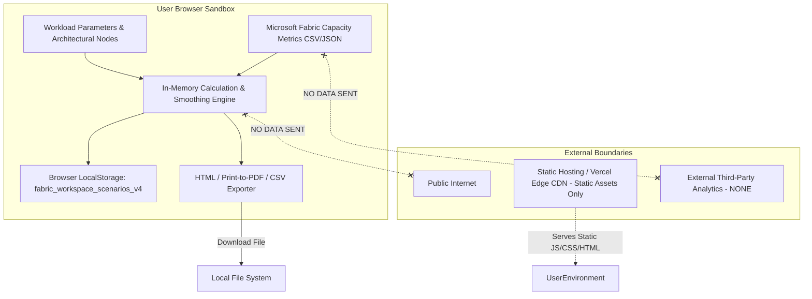

# Fabric Master v4.0 — Privacy & Data Flow Architecture

**Status:** Complete & Verified  
**Audit Date:** October 2026  
**Classification:** Privacy Architecture & Compliance Specification  

---

## 1. Privacy Principles & Commitments

Fabric Master v4.0 adheres to a strict "Privacy by Default" architecture:

1. **Local Sandbox Execution:** All workload modeling, telemetry parsing, diagramming, and calculations execute entirely in the user's web browser.
2. **Zero Involuntary Exfiltration:** No capacity metrics, workspace names, or architecture topology data is ever uploaded to remote servers or analytics providers.
3. **No Mandatory Account Requirement:** Full workbench capabilities (capacity sizing, FinOps comparisons, architecture design, observability diagnostics, report exports) are accessible without account registration or credit card entry.
4. **Transparent Data Provenance:** When users export scenarios or reports, all formulas, pricing dates, and calculation versions are openly disclosed in the document metadata.

---

## 2. System Data Flow Diagram

---

## 3. Data Lifecycle & Storage Controls

### 3.1 Local Storage Keys
- **Primary Scenarios Key:** `fabric_workspace_scenarios_v4`
  - *Content:* Array of user scenarios, custom workload inputs, and active selections.
  - *Format:* JSON stringified with schema version tag `"4.0"`.
  - *Location:* Browser `localStorage` (Origin: `https://fabric.dattasable.com`).
  - *Retention:* Indefinite until cleared by user or browser cache reset.
- **Theme Preference Key:** `fabric_theme`
  - *Content:* `"dark"` or `"light"`.

### 3.2 User Data Management Controls
The Workspace UI provides five explicit user data controls:
1. **Save Scenario:** Persists current inputs and calculation outputs to local storage.
2. **Export Scenario (JSON):** Serializes clean, sanitized JSON to local disk for enterprise sharing.
3. **Import Scenario (JSON):** Reads local JSON file into browser memory with schema validation.
4. **Delete Scenario:** Removes single selected scenario from storage.
5. **Clear All Data:** Purges all local workbench keys from browser storage immediately.

---

## 4. Privacy Audit Checklist

| Requirement | PRD Reference | Implementation Status | Evidence |
|---|---|---|---|
| **No Undisclosed Telemetry** | PRD §27 | PASS | Telemetry parser runs 100% client-side in `src/lib/observability.ts`. |
| **No Hidden File Transmission** | PRD §27 | PASS | Network panel verifies zero POST/PUT requests during CSV/JSON upload. |
| **No Mandatory Account** | PRD §27 | PASS | Full application accessible anonymously. |
| **Clear Local-Storage Explanation** | PRD §27 | PASS | Workspace and Trust Center document local storage usage. |
| **Data Deletion Controls** | PRD §27 | PASS | Local storage clear and scenario delete buttons implemented. |
| **No Credentials in Exported Reports** | PRD §27, §22 | PASS | `generatePrintableHTMLReport()` excludes sensitive tokens and tenant keys. |
| **AI Privacy Controls** | PRD §27, AC-022 | PASS | Sanitization applied before prompt generation; local grounding. |
